# Slide Handouts

A free Claude Code plugin that turns slides into a printable handout with room for notes. You choose how many slides go on a page, how big they are, and whether the notes space has lines, a dot grid, blank space or a box you can type into. The plugin remembers your usual layout, so next time you only need to say "make me a handout".

It reads three kinds of file:

1. A handout PDF exported from PowerPoint or Keynote, with small slides and a few lines beside them.
2. A deck saved straight to PDF, one slide per page, from PowerPoint, Keynote or Google Slides.
3. A PowerPoint or Keynote file. You export it to PDF yourself, or ask Claude to do it for you.

The slides stay sharp at any size, because they are placed as they are, never turned into pictures.

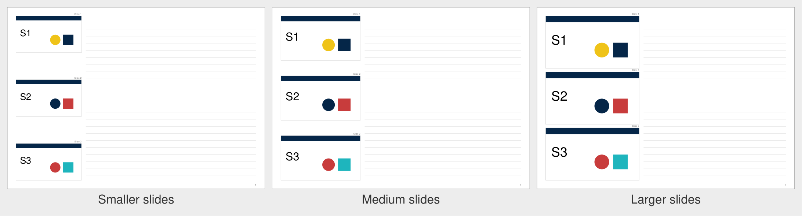

## Install

You need Claude Code, in the terminal or in the Code tab of the Claude desktop app. The plugin is tested on macOS. Windows is expected to work but is not yet tested, and Linux should work but is not tested.

### Step 1 - install uv

The plugin uses uv to run its script. uv fetches everything else the first time the plugin runs.

On a Mac, open Terminal and run:

```bash
curl -LsSf https://astral.sh/uv/install.sh | sh
```

On Windows, open PowerShell and run:

```powershell
powershell -ExecutionPolicy ByPass -c "irm https://astral.sh/uv/install.ps1 | iex"
```

Then close and reopen the terminal.

### Step 2 - add the plugin in the terminal

1. Start Claude Code.
2. Type `/plugin marketplace add juliandickie/slide-handouts-plugin` and press Return.
3. Type `/plugin install slide-handouts@slide-handouts-plugin` and press Return.
4. Quit Claude Code and start it again.

### Step 2 - or add the plugin in the Claude desktop app

1. Open the Code tab.
2. Type `/plugin marketplace add juliandickie/slide-handouts-plugin` and press Return.
3. Type `/plugin install slide-handouts@slide-handouts-plugin` and press Return.
4. Quit the Claude desktop app and open it again.

## Using it

Put your file in the folder you work in, then ask in plain words. For example:

- "Make a handout from Talk.pdf, 3 slides per page, lines beside each slide."
- "Turn Workshop.pdf into a handout with big slides and a dot grid under each one."
- "Make a handout from Lecture 4.pdf with a box to type notes into, using example 5."
- "Use example 6 for Seminar.pdf, but on US Letter paper."
- "Make me a handout from Week 2.pdf." (This uses your usual layout, once you have saved one.)

Claude asks about any option you did not mention, makes the handout beside your file, checks it, and tells you where it is.

If you have a PowerPoint, Keynote or Google Slides deck, export it to PDF first. The [export guide](guide/export-your-slides.md) shows how, step by step, for each app.

## The options

**Paper.** A4 or US Letter.

**Orientation.** Portrait (upright pages) or landscape (sideways pages).

**Slides per page.** 1, 2, 3, 4 or 6. More slides per page means fewer pages to print and smaller slides.

**Notes position.** Beside each slide, under each slide, or both. Notes beside suit wide pages and short notes per slide. Notes under give each slide a full-width writing area.

**Notes style.** Ruled lines, a dot grid, blank space, or a typeable box. Lines and dots suit pens. Blank space suits sketches and diagrams. A typeable box makes the PDF fillable, so you can type notes on screen. A box works beside or under each slide, not both.

**Spacing.** For lines and dots, the gap between them, from 4 to 12 mm. Narrow is 6 mm, medium is 7 mm and wide is 8 mm, and any value in between works. Wider spacing suits larger handwriting and gives fewer lines.

**Slide size.** Smaller, medium or larger, or an exact width in millimetres. Larger is the biggest slide that still leaves room for notes. Medium is 85 percent of that width, and smaller is 70 percent. Bigger slides are easier to read and leave less room to write. Slides under 70 mm wide still build, with a note that small text may be hard to read.

## Gallery

Each example is page 1 of a handout made from a made-up 12-slide deck. Ask for one by its number, for example "use example 6", and change any option you like, for example "example 6 with lines".

### Example 1

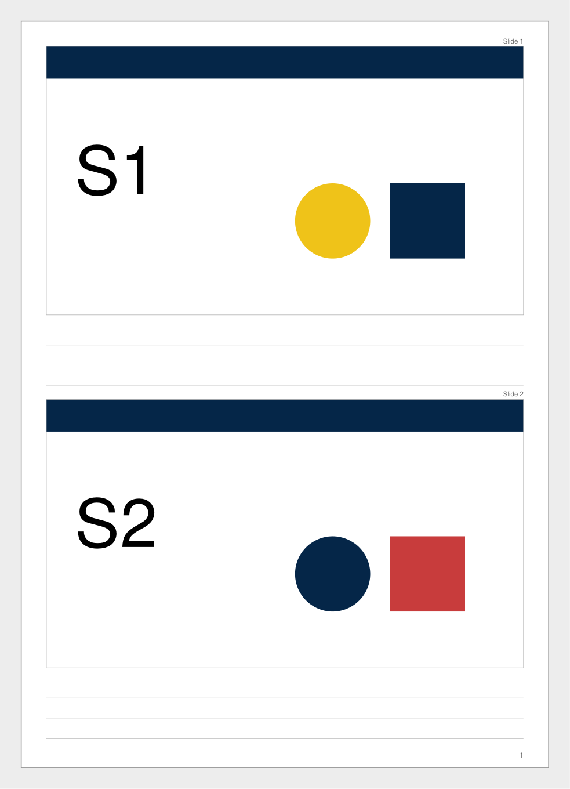

A4 portrait, 2 slides per page, lines under each slide (8 mm apart), larger slides

### Example 2

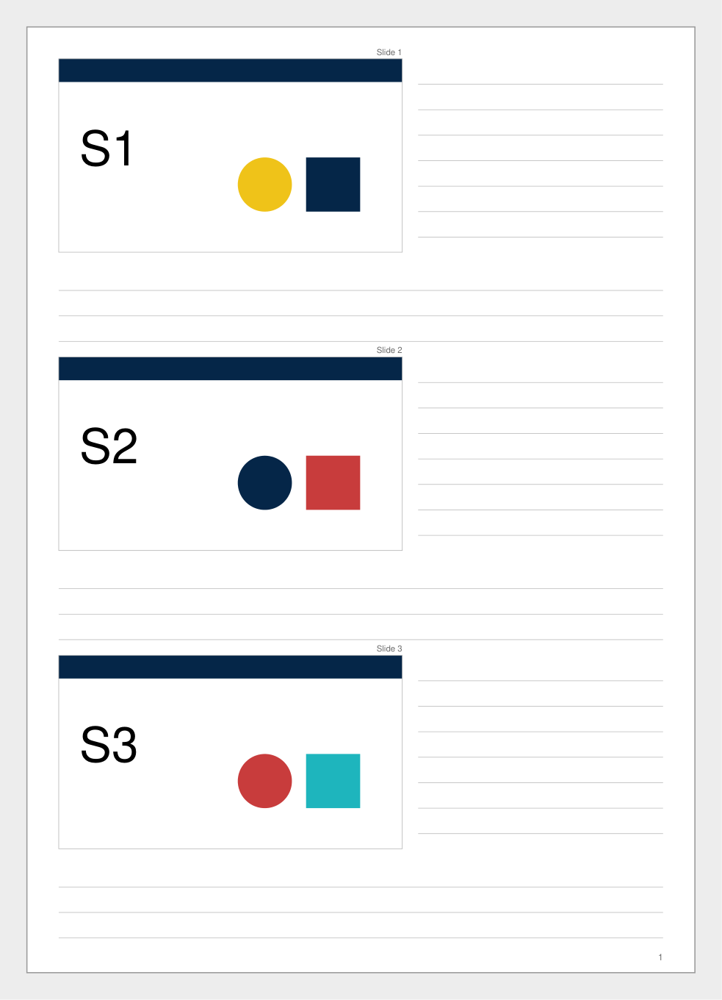

A4 portrait, 3 slides per page, lines beside and under each slide (8 mm apart), slides 108 mm wide

### Example 3

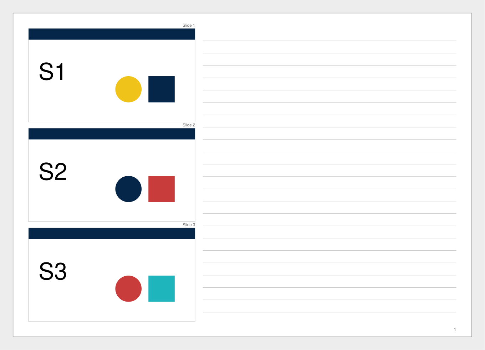

A4 landscape, 3 slides per page, lines beside each slide (8 mm apart), larger slides

### Example 4


A4 portrait, 3 slides per page, lines beside each slide (8 mm apart), larger slides

### Example 5

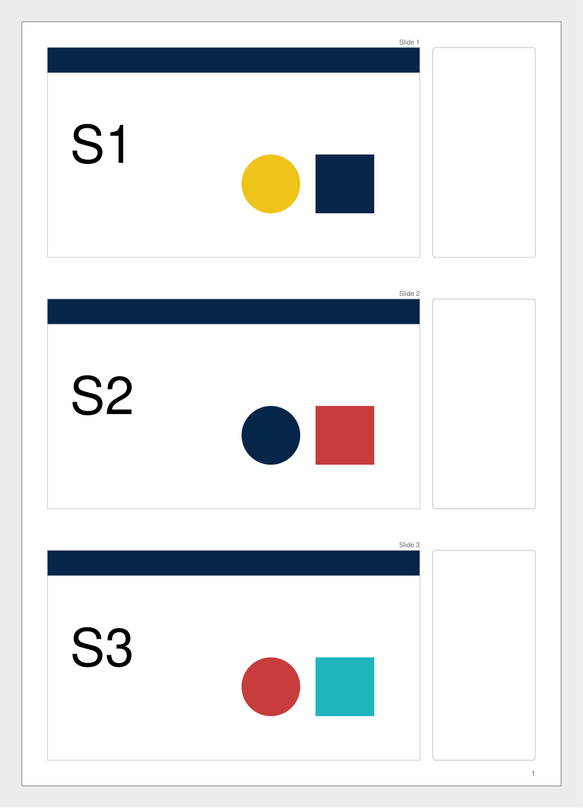

A4 portrait, 3 slides per page, a typeable box beside each slide, larger slides

### Example 6

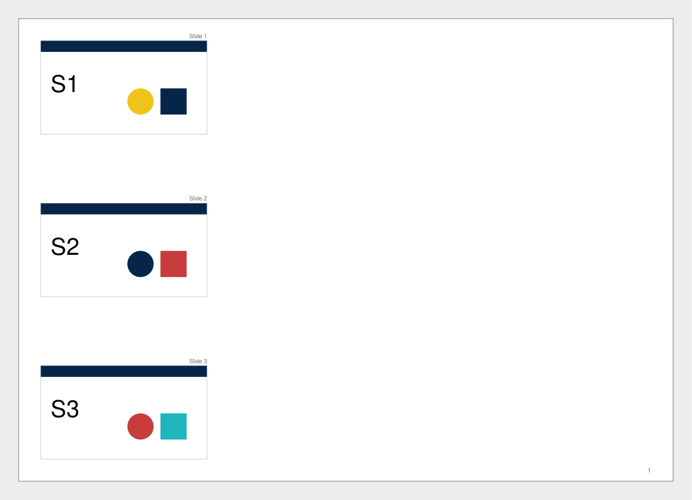

A4 landscape, 3 slides per page, dots beside each slide (5 mm apart), smaller slides

### Example 7

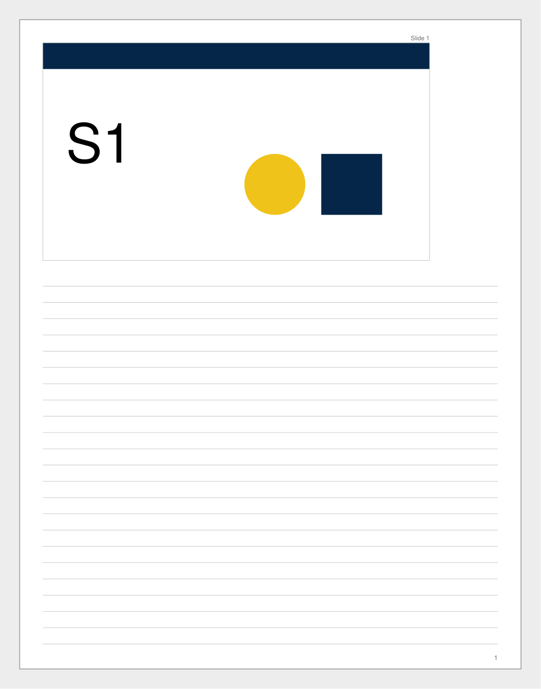

Letter portrait, 1 slide per page, lines under each slide (7 mm apart), medium slides

### Example 8

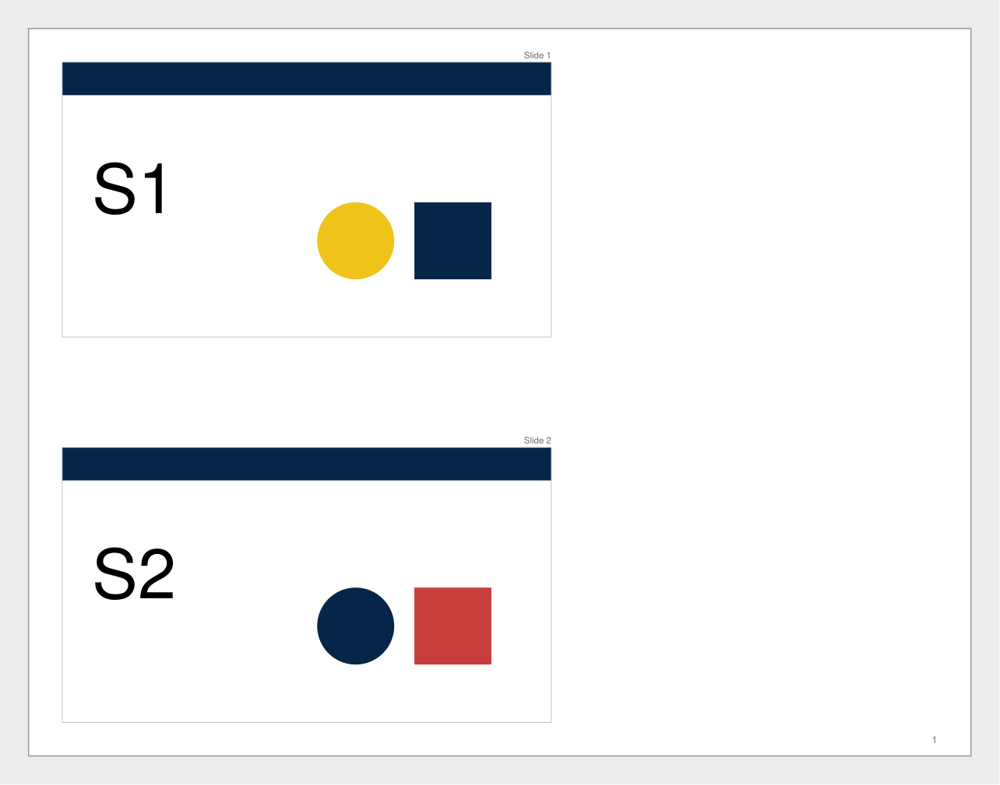

Letter landscape, 2 slides per page, blank space beside each slide, medium slides

### Example 9

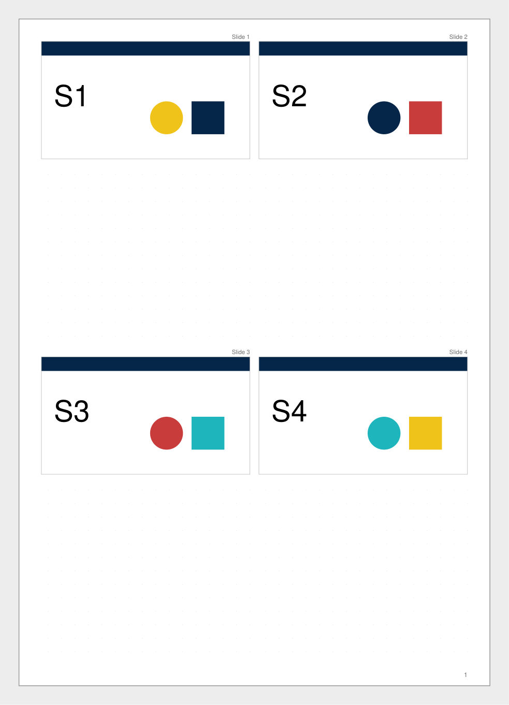

A4 portrait, 4 slides per page, dots under each slide (6 mm apart), larger slides

### Example 10

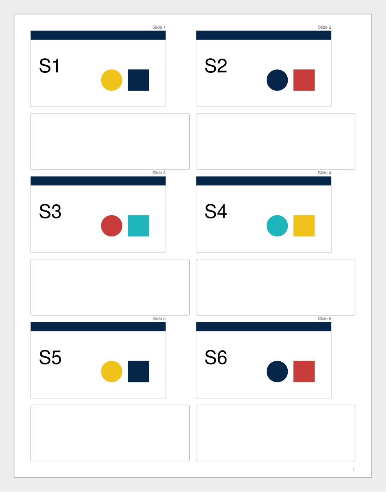

Letter portrait, 6 slides per page, a typeable box under each slide, medium slides

### Example 11

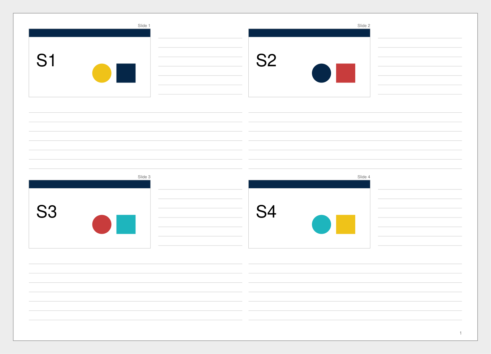

A4 landscape, 4 slides per page, lines beside and under each slide (6 mm apart), medium slides

## Saved layouts

After Claude makes a handout with options you have not saved, it asks once whether to save them, under what name, and whether to make them your usual layout. When you have a usual layout, Claude offers it first, in plain words, and you can accept it or change any option.

You can also ask at any time:

- "Save these options as my workshop layout."
- "Make my workshop layout my usual."
- "Show my saved layouts."
- "Delete my workshop layout."

Saved layouts live on your own computer, in `~/.config/slide-handouts/layouts.json` (on Windows, `%USERPROFILE%\.config\slide-handouts\layouts.json`). The file holds layout options only, never file names or slide content. The gallery examples cannot be saved over or deleted.

## Things to know

**Typed notes.** In a typeable box, notes scroll when they run past the box on screen. A printed copy shows only what fits in the box.

**Slide numbers and hidden slides.** Each slide is labelled "Slide N". In a PowerPoint handout PDF, the numbers are the ones PowerPoint printed, so they skip hidden slides. Keynote numbers its handout slides 1, 2, 3 and so on over the slides it shows, so its numbers do not count skipped slides. In a PDF with one slide per page, slides are numbered in page order. To keep each slide's number from the original deck when it has hidden slides, give Claude the PowerPoint file as well as the PDF.

**Handouts with no printed numbers.** Claude shows you page 1 with the order it found and asks you to check it, because some handouts run down columns instead of across rows.

**Keynote handouts.** Keynote's 3-per-page handout export is tested and works. Keynote handouts with 2, 4 or 6 slides per page are not yet tested. A Keynote deck exported one slide per page always works.

**Mac and Windows.** Handout detection was tested on exports from PowerPoint and Keynote for Mac. PowerPoint for Windows is expected to give the same handouts, but this is not yet tested. The plugin is expected to work on Windows, but it is not yet tested there.

**Photos that may print soft.** If a photo would print at under 150 pixels per inch at its new size, Claude names the slides it is on. The handout is still made. A fresh export from the original deck may be sharper.

**Your files are safe.** The plugin never changes your file and never replaces an earlier handout. A new handout with a name that is already taken gets `_v2`, `_v3` and so on.

## When a file is refused

The plugin stops rather than guess, because a handout with slides in the wrong order is worse than none. Exporting the deck straight to PDF, one slide per page, always works. The [export guide](guide/export-your-slides.md) shows how.

### No slide frames

**What it says:** "This looks like a printed page with no slide frames. If each page is one slide, run again with --one-per-page. Otherwise export the deck straight to PDF, one slide per page."

**What to do:** If each page of your PDF is one slide, tell Claude so, and it tries again. Otherwise export the deck again. Scanned or photographed handouts give this message too, and cannot be read.

### Slide order cannot be trusted

**What it says:** one of "The pages have mixed page sizes", "The slide frame counts vary between pages", "Slide frames overlap on page N", "The printed slide numbers repeat or go down" or "Only some slides have printed numbers".

**What to do:** Export the deck straight to PDF, one slide per page.

### The file cannot be opened

**What it says:** "could not be opened. It may be damaged, or not a PDF", "is protected by a password. Export it again without one" or "has no pages".

**What to do:** Export the PDF again from the slide app, with no password.

### The PDF and the deck do not match

**What it says:** "The PDF has N pages, but the deck has M slides with K hidden. The labels cannot be trusted, so nothing was built."

**What to do:** Export the PDF again from that same deck, then try again with both files.

### Claude could not convert the deck

**What it says:** "No app that can convert the file is installed here", "Could not convert the file" or "macOS did not allow Claude to control the app".

**What to do:** Export the PDF yourself, as the export guide shows. To let Claude convert decks, follow "Letting Claude convert for you" in the export guide.

### The handout cannot be saved there

**What it says:** "Could not write to the folder. Name another place with --out."

**What to do:** Ask Claude to save the handout in another folder.

### Saved layouts cannot be read

**What it says:** "The saved layouts file could not be read. It was not changed. Fix it, or move it aside to start again."

**What to do:** Move `layouts.json` out of its folder, and save your layouts again.

## Licence

Slide Handouts is free and open source under the MIT licence. It uses PyMuPDF, which is licensed under the GNU AGPL. The two are compatible here, because the plugin's own code is open and PyMuPDF is fetched by uv when the plugin runs, not bundled with it.
