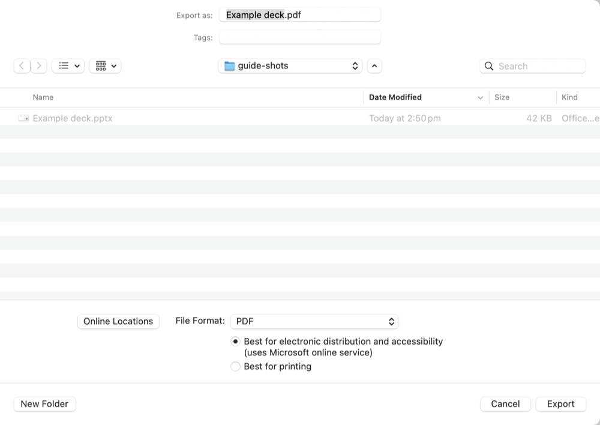
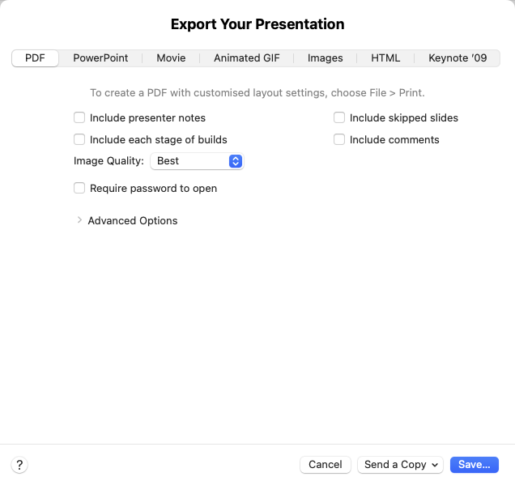
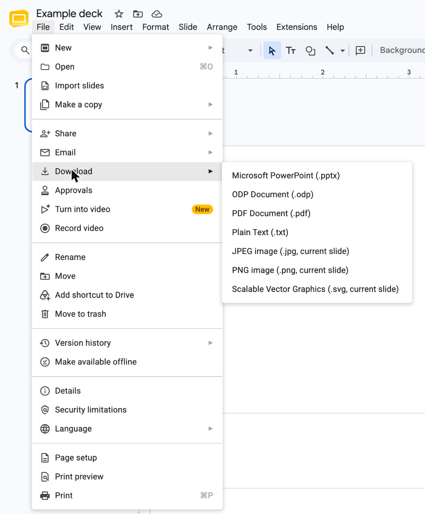
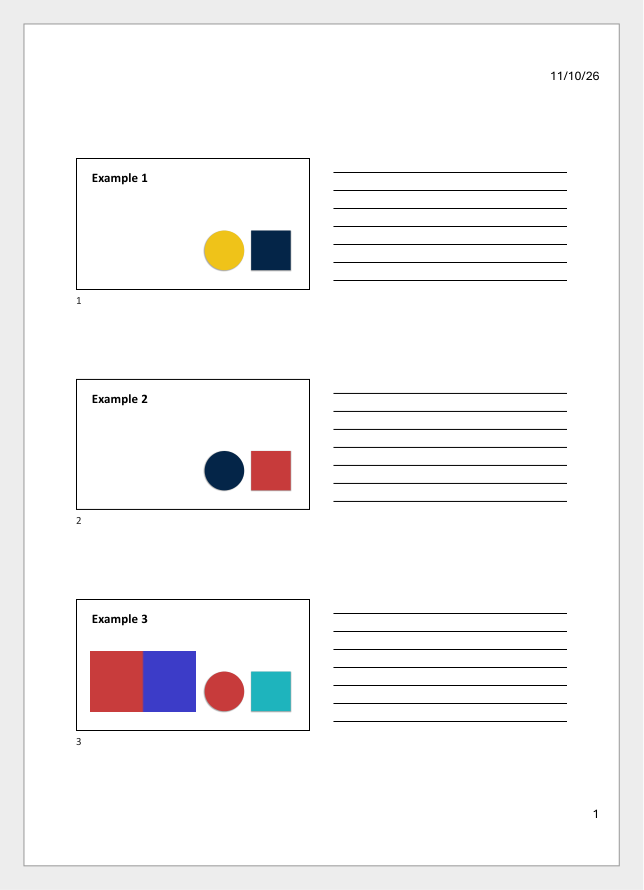

# Export your slides to PDF

Slide Handouts reads a PDF of your slides. This guide shows how to make that PDF in PowerPoint, Keynote and Google Slides.

The export that always works is straight to PDF, with one slide on each page. Every app below does this from its normal export menu. When the PDF is ready, ask Claude to make your handout from it, as the [README](../README.md#using-it) shows.

## PowerPoint for Mac

1. Open your deck in PowerPoint.
2. Choose File > Export.
3. Next to File Format, choose PDF.
4. Under File Format, choose either option. "Best for printing" makes the PDF on your Mac. "Best for electronic distribution and accessibility" sends the deck to Microsoft's online service to make the PDF.
5. Choose where to save the PDF.
6. Click Export.

PowerPoint leaves hidden slides out of the PDF. To keep each slide's number from the deck, give Claude the .pptx file as well as the PDF.

## Keynote

1. Open your deck in Keynote.
2. Choose File > Export To > PDF.
3. Make sure that "Include skipped slides" is not ticked.
4. Make sure that "Include presenter notes" is not ticked. Slide Handouts cannot read pages with notes under each slide.
5. Make sure that "Include each stage of builds" is not ticked. Otherwise a slide with builds becomes several pages.
6. Click Save. In older versions of Keynote, this button says Next.
7. Choose where to save the PDF, and save it.

## PowerPoint for Windows

These steps are not yet tested on Windows.

1. Open your deck in PowerPoint.
2. Choose File > Export.
3. Choose Create PDF/XPS Document.
4. Click Create PDF/XPS.
5. Make sure that "Save as type" says PDF.
6. Click Options.
7. Make sure that "Publish what" says Slides, and that "Include hidden slides" is not ticked.
8. Click OK.
9. Choose where to save the PDF.
10. Click Publish.

## Google Slides

1. Open your deck in Google Slides.
2. Choose File > Download > PDF Document (.pdf).
3. Find the PDF in your Downloads folder.

## If you only have a handout PDF

Slide Handouts also reads handout PDFs exported from PowerPoint and Keynote, with several small slides on each page. It finds each slide by the thin frame around it. These two pages are the kind it reads.

Scanned or photographed pages cannot be read, because they hold a picture of the slides, not the slides themselves. If you have the original deck, export it one slide per page instead.

## Letting Claude convert for you

This is optional. Exporting the PDF yourself, as above, is the default, and it needs no extra permissions.

If you would rather not export it yourself, Claude can open a PowerPoint or Keynote file and save the PDF for you. Ask in plain words, for example "convert Talk.pptx for me".

**What it needs:** PowerPoint or Keynote installed on a Mac, or PowerPoint on Windows. Google Slides has no automatic conversion.

**Fonts:** When Keynote converts a PowerPoint file, fonts can shift. Claude tells you which app converted the file.

### On a Mac, the first time

1. When macOS asks whether the app you run Claude Code in may control PowerPoint or Keynote, click OK.
2. If PowerPoint shows a "Grant File Access" window, click Select.
3. Click Grant.
4. If Keynote seems to wait with nothing on screen, switch to Keynote and look for a window asking for access to the folder, then allow it.

### If you said no to the macOS question

Claude stops and tells you so. To allow it later:

1. Open System Settings.
2. Click Privacy and Security.
3. Click Automation.
4. Find the app you run Claude Code in, such as Terminal or Claude.
5. Turn on PowerPoint or Keynote under it.
